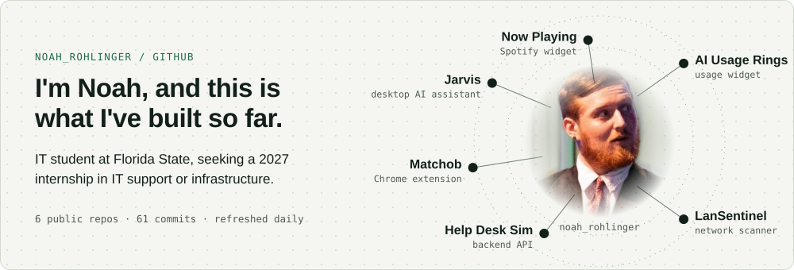

  <picture>
    <source media="(prefers-color-scheme: dark)" srcset="https://raw.githubusercontent.com/noahrohlinger40-commits/noahrohlinger40-commits/main/card-dark.svg">
    
  </picture>

## What I'm building

- **[Jarvis](https://github.com/noahrohlinger40-commits/Jarvis)**: a voice assistant for Windows built to run on local AI models. Wake word, speech recognition, memory, reminders and 67 tools that work with apps, files and the browser. C#, .NET 8, Windows Forms.
- **[Help Desk Sim](https://github.com/noahrohlinger40-commits/Help-Desk-Sim)**: the backend for an IT help desk. Tickets with SLA timers that skip nights and weekends, breach emails and escalation, admin and technician roles, and an audit trail of every change. ASP.NET Core, C#.
- **[Matchob](https://github.com/FSU-CloudClub/CloudClub-Fall2027-Matchob)**: a Chrome extension from FSU's AWS Cloud Club that tailors a resume to a job posting. I lead the AI team and built the checks that stop it from inventing claims.
- **[AI Usage Rings](https://github.com/noahrohlinger40-commits/ai-usage-rings)**: a small desktop widget that shows how much of my Claude, Fable and Codex usage I've used, and whether an agent is working or waiting on me. Python, tkinter.
- **[Now Playing](https://github.com/noahrohlinger40-commits/now-playing)**: a small Spotify widget with the cover, the song, and buttons to like, skip, pause and change the volume, plus synced lyrics and muted ads. Python, tkinter.
- **[LanSentinel](https://github.com/noahrohlinger40-commits/LanSentinel)**: a Java network scanner. Give it an IP, a range or a subnet and it checks every device in parallel and reports which ones are online.

## Latest activity

<!-- activity:start -->
- **[My-Website](https://github.com/noahrohlinger40-commits/My-Website/releases/tag/update-4) update-4**: Update 4 · 2 weeks ago
- **[Jarvis](https://github.com/noahrohlinger40-commits/Jarvis/releases/tag/v1.2.0) v1.2.0**: A wake-word model, a prompt-injection guard, and Jarvis's own engine · 2 weeks ago
- **[Jarvis](https://github.com/noahrohlinger40-commits/Jarvis/releases/tag/v1.1.0) v1.1.0**: Lecture notes, calendar, and a local voice · 1 month ago
- Rebuild the site around the 3D network map · [My-Website](https://github.com/noahrohlinger40-commits/My-Website/commit/cbe1260c9ddcfce9bf66513770adf6fc957275bb) · yesterday
- Update the AI README's who-works-where table and remove empty placeholder files · [CloudClub-Fall2027-Matchob](https://github.com/FSU-CloudClub/CloudClub-Fall2027-Matchob/commit/efe9051d9d19b8eb025bdec468e5667eb686cb79) · 3 days ago
- Use read_json in suggest and requirements instead of their own parsing · [CloudClub-Fall2027-Matchob](https://github.com/FSU-CloudClub/CloudClub-Fall2027-Matchob/commit/b35770707ccaccf7c075586eafc2caff2ccb6524) · 3 days ago
- Derive the growth-word forms and trim the heading list · [CloudClub-Fall2027-Matchob](https://github.com/FSU-CloudClub/CloudClub-Fall2027-Matchob/commit/0f1bed54eee23063ebb765da4d6cd3d6b4135fad) · 1 week ago
- Check rank and club titles, noun forms of led, half-new wording and any section heading · [CloudClub-Fall2027-Matchob](https://github.com/FSU-CloudClub/CloudClub-Fall2027-Matchob/commit/bb86202eaa54fe782dddcb636d2fee27cf61dd7c) · 1 week ago

_Updated daily by a GitHub Action._
<!-- activity:end -->

## Find me

[Portfolio](https://noahrohling.netlify.app) · [LinkedIn](https://www.linkedin.com/in/noah-rohlinger)
